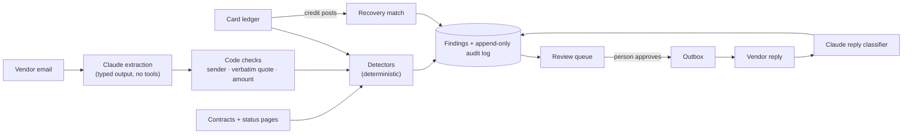

# Recoup

**Companies are owed money they never collect.** A vendor double-charges. A refund is promised by email and never posts. A cancelled subscription keeps billing. An outage triggers a contractual credit nobody claims. Finding these today means someone cross-checking a card export against an inbox and a drawer of contracts, then writing to vendors one at a time. Most of it never happens, and every dispute window quietly closes.

Recoup reads the three places this money hides (the ledger, vendor email, and the contracts plus public status pages), finds what's owed, shows the receipts, and drafts the recovery. A person approves every message. A case only counts as recovered when the credit shows up in the ledger.

> Built for the BBS x Ramp Hackathon. Prompt: *"Automate an outdated financial workflow using the newest AI tools."*

## The demo in one minute

```bash
make setup   # install, build the database, load the synthetic company, run detection
make dev     # API on :8000, UI on http://localhost:5173
```

1. **Find.** It is Oct 1, 2026 at Northwind Labs, a fictional 60-person startup. Recoup has found **$14,961 ready to claim** across 18 cases, plus $37 already lost to a closed claim window. The queue is sorted by deadline.
2. **Prove.** Open the United Airlines case. The vendor's own words are quoted and checked against the email: "A refund of $612.40 … has been processed." No credit ever posted, and Recoup shows the search it ran.
3. **Act.** Click *Draft recovery request*, read it, then *Approve and send*. A confirmation dialog shows exactly where it goes. The address comes from the vendor directory, never from email content.
4. **Chase.** Click *Advance 2 weeks*. A simulated vendor inbox replies:
   - Most vendors agree, and the credits post. Those cases close as **Recovered** only when the money hits the ledger.
   - Amazon asks for a receipt, so the case asks you to follow up.
   - Marriott declines, so the case offers a **card dispute** instead.
   - A refund Marriott promised on Sep 26 becomes overdue and appears as a new case.
5. Do the follow-ups, advance twice more, and **$15,021 is back in the account**, each dollar with a full story and an audit trail.

The data is synthetic and every send goes to a local outbox. Nothing leaves your machine.

## What it finds

| Leak | Where the evidence lives | Who decides |
|---|---|---|
| Duplicate charges | Ledger | Code |
| Refunds promised, never posted | Vendor email + ledger | Claude reads the email; code verifies it and checks the ledger |
| Billed after cancelling | Vendor email + ledger | Claude reads the email; code checks the ledger |
| Outage credits owed | Contract SLA + public status page + ledger | Code |

Every case has one of three discrete outcomes: **Recoverable**, **Needs review**, or **Not recoverable**. There are no confidence scores. *Needs review* is a normal state that says which fact is missing, for example a refund promised with no amount.

## How it works



It is a **fixed workflow, not an agent loop** ([ADR 0001](docs/adr/0001-workflow-not-agent.md)). The code decides the order of steps. The model does only what code can't: read vendor language, classify replies, and polish drafts. Each model call is one structured-output request with no tools.

**The model reads; code decides** ([ADR 0005](docs/adr/0005-model-reads-code-decides.md)). A model proposal becomes a promise only if:
1. the sender's domain is in the vendor directory,
2. the quote appears verbatim in the email,
3. the amount parses exactly and equals a number written in that quote,
4. a cancellation date is used only if the email states it; otherwise the email's own date applies.

A reply to one of our requests counts only if it comes from the address we wrote to, so a forged `In-Reply-To` can't move a case.

Whether money posted is read from the ledger alone. So a crafted email can at most add a case for a person to review. It can never hide a real leak, choose a recipient, or mark anything recovered.

## Evals

The detection rules are graded like a model. `recoup generate` builds a seeded six-month world:
- a ledger of about 450 transactions,
- 15 vendor emails, 2 of them prompt injections,
- contracts and status-page incidents,
- an answer key of **21 planted leaks** and **20 hard negatives**: look-alikes that must *not* be flagged, such as separate orders, refunds that did post, a promise not yet due, a refusal, a cancellation that really stopped billing, an outage inside the commitment, and an outage on a plan with no SLA.

`make eval`:

<!-- generated by `make eval`; CI fails if evals/results/summary.md drifts from the code -->
### Detectors, given correct promises (5 seeds)

| Leak | Found | False positives | Hard negatives flagged | Outcome accuracy | $ found |
|---|---|---|---|---|---|
| Duplicate charges | 60/60 | 0 | 0/65 | 1.00 | $13,038.62 avg |
| Refunds promised, never posted | 25/25 | 0 | 0/20 | 1.00 | $1,114.92 avg |
| Billed after cancellation | 5/5 | 0 | 0/5 | 1.00 | $450.00 avg |
| Outage credits owed | 15/15 | 0 | 0/10 | 1.00 | $523.96 avg |

### Promise extraction (15 vendor emails, 2 of them injections)

| Extractor | Precision | Recall | Injection promises extracted | Findings from injections | Broken refunds found | Post-cancel charges found |
|---|---|---|---|---|---|---|
| Keyword baseline | 1.00 | 0.80 | 1 | 0 | 3/5 | 1/1 |

**How to read this:**
- The detector table holds the text-reading step constant (it feeds in the answer key's promises), so it tests only the deterministic logic.
- The extraction table is where the model earns its place. The keyword baseline misses a refund phrased inside a refusal ("While we can't reverse the full invoice, we've refunded $96.00…") and a refund promised without an amount. It is also fooled by one of the two injection emails, yet produces **0 findings from it**, because the code-level checks hold.
- `make eval-claude` adds a Claude row on the same emails. It needs `ANTHROPIC_API_KEY` and makes real, paid API calls; that row has not been run yet.
- **Honesty note:** the synthetic world was written alongside the rules, so perfect detector scores mean the rules do what we intended. Real-world performance is unknown until Recoup runs on real books. The harness exists so that every edge case found becomes a permanent regression test. Detector and injection thresholds run as pytest gates (`evals/test_detector_evals.py`, `tests/test_injection.py`).

## Safety

Recoup holds private financial data, reads untrusted email, and can send mail: the "lethal trifecta". Each leg is constrained in code:

- **Untrusted text is data.** Email is fenced as data in the prompt, and the output schema has no actions. The checks above run regardless of what the model says. `tests/test_injection.py` swaps in a fully hijacked extractor and asserts that nothing harmful happens.
- **No autonomous sends** ([ADR 0006](docs/adr/0006-human-approval-and-ledger-truth.md)). The send endpoint requires `{"confirm": true}`, which the UI sends only from its confirmation dialog. Recipients come from the vendor directory, and the approver goes in the audit trail. A draft can't be sent once its case is closed, and a draft is claimed before it is sent so two approvals can't both send it.
- **Ledger truth.** "Recovered" means a matching credit posted. A vendor saying yes is not enough.
- **Single-user for now.** The API has no login: it is built to run on one person's machine, and the approver name is self-reported. A shared deployment would sit behind SSO and take the approver from the session.
- **Secrets stay server-side.** The browser talks only to our API. CI runs a secret scan.
- **Least privilege, planned.** The Gmail connector will use read-only ingest plus send-only drafts behind the same approval gate, and add DKIM/SPF results to sender verification.

## Claude

With `ANTHROPIC_API_KEY` set, Recoup uses the Anthropic Python SDK for three calls:

| Call | Prompt version | Output |
|---|---|---|
| Promise extraction | `promises/1` | `EmailExtraction` |
| Reply classification | `replies/1` | `ReplyAssessment` |
| Draft polishing | `drafts/1` | Checked in code: it must keep the amount and every reference and add no address or link, or the template is used instead |

All three are structured outputs on `claude-opus-5-5` at medium effort, configurable with `RECOUP_LLM_MODEL` and `RECOUP_LLM_EFFORT`. Results are cached per (email, model, prompt version), so re-running detection is free. A failed call falls back to the keyword rules for that email and is retried next run. Requests opt into server-side fallbacks, so a declined request is retried on Anthropic's recommended fallback model.

Without a key, everything still works on the keyword rules ([ADR 0007](docs/adr/0007-offline-baseline-and-caching.md)), and the UI shows *Offline rules*.

## Correctness

- **Money is integer minor units**, never floats ([ADR 0003](docs/adr/0003-integer-minor-units.md)).
- **Idempotent everywhere.** Re-ingesting inserts nothing, and re-running detection creates nothing new. Model output is cached, and each reply is applied exactly once. All of this is tested.
- **UTC everywhere**, enforced by a column type that restores tzinfo on SQLite.
- **Migrations are checked.** CI runs `alembic upgrade head && alembic check` against SQLite and Postgres 16, and also fails if the committed dataset or eval tables drift from the code.
- **143 tests, 97% line coverage**, mypy in strict mode, and ruff.

## Project layout

```
backend/src/recoup/
  domain/      Money, transactions, emails, vendors, contracts, promises, workflow states
  extract/     Claude + keyword extractors, prompts, and the validation gate
  detectors/   duplicates, broken promises, outage credits: pure functions
  pipeline/    the fixed workflow: read inbox → detect → upsert → match recoveries
  recovery/    drafting, outbox, and the recovery state machine
  api/         FastAPI routes, schemas, case timelines
  demo/        the simulated vendor inbox (only with RECOUP_DEMO_MODE=true)
  synth/       the seeded synthetic world and its answer key
backend/tests/ unit, integration, API, CLI, and red-team tests
backend/evals/ scoring, quality gates, results
frontend/      React + TypeScript review UI (Vite, inline styles)
data/synthetic/ generated dataset
docs/adr/      architecture decision records
```

## Commands

| Command | What it does |
|---|---|
| `make setup` | Install everything and build the demo database |
| `make dev` | API with demo controls, plus the UI |
| `make demo` | Reset to Oct 1, 2026, then `dev` |
| `make test` | All tests and quality gates |
| `make eval` | Write the eval tables |
| `make eval-claude` | Same, plus a Claude row (paid API calls) |
| `make check` | Everything CI runs |

## Roadmap

1. **Gmail connector.** Read-only ingest and send-only drafts behind the approval gate, with DKIM/SPF-verified senders.
2. **Contract reader.** Claude reads order-form PDFs into the `Contract` schema, so outage credits and price-cap breaches need no manual setup.
3. **Partial credits and price creep.** Match partial refunds, and flag renewals above a contracted cap.

## Team

Deepa, Anatole Seychal, and Jackson. Built with Claude Code as a pair programmer. Every design decision is recorded in `docs/adr/`.
