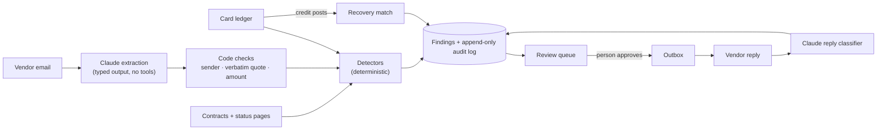

# Recoup

**Companies are owed money they never collect.** A vendor double-charges. A refund is promised by email and never posts. A cancelled subscription keeps billing. An outage triggers a contractual credit nobody claims. A price the order form locked creeps up anyway. Finding these today means someone cross-checking a card export against an inbox and a drawer of contracts, then writing to vendors one at a time. Most of it never happens, and every dispute window quietly closes.

Recoup reads the three places this money hides (the ledger, vendor email, and the contracts plus public status pages), finds what's owed, shows the receipts, and drafts the recovery. A person approves every message. A case only counts as recovered when the credit shows up in the ledger.

> Built for the BBS x Ramp Hackathon. Prompt: *"Automate an outdated financial workflow using the newest AI tools."*

## The demo in one minute

```bash
make setup   # install, build the database, load the synthetic company, run detection
make dev     # API on :8000, UI on http://localhost:5173
```

1. **Find.** It is Oct 1, 2026 at Northwind Labs, a fictional 60-person startup. Recoup has found **$14,961 ready to claim** across 18 cases, plus $37 already lost to a closed claim window. The queue is sorted by deadline.
2. **Prove.** Open the United Airlines case. The vendor's own words are quoted and checked against the email: "A refund of $612.40 … has been processed." No credit ever posted, and Recoup shows the search it ran.
3. **Act.** Click *Draft recovery request*, read it, then *Approve and send*. A confirmation dialog shows exactly where it goes. The address comes from the vendor directory, never from email content.
4. **Chase.** Click *Advance 2 weeks*. A simulated vendor inbox replies:
   - Most vendors agree, and the credits post. Those cases close as **Recovered** only when the money hits the ledger.
   - Amazon asks for a receipt, so the case asks you to follow up.
   - Marriott declines, so the case offers a **card dispute** instead.
   - A refund Marriott promised on Sep 26 becomes overdue and appears as a new case.
5. Do the follow-ups, advance twice more, and **$15,021 is back in the account**, each dollar with a full story and an audit trail.

The data is synthetic and every send goes to a local outbox. Nothing leaves your machine.

## Your company's data

Recoup runs on any company's data, not just the demo. Open **Setup** in the app (`#/setup`) and work down five steps ([ADR 0012](docs/adr/0012-company-onboarding.md)):

1. **Your company.** The name drafts are signed with, and where card disputes go.
2. **Ledger.** Upload a CSV export from any card, bank or accounting tool. Recoup shows what it read and lets you fix the columns before importing. Detection runs on import, and importing the same file again adds nothing. Teams on Ramp can connect it instead (below).
3. **Vendors.** Recoup lists merchants on your ledger it doesn't know yet, by spend. For each one, type the billing address to write to. Recoup never takes an address from an email.
4. **Finance inbox.** With a Google OAuth client set on the server (steps 1 to 3 under Gmail below), **Connect Gmail** asks for read-only access and keeps the token on the server.
5. **Contracts.** Upload an order form or MSA. Claude reads it, the grounding gate checks every term, and nothing is saved until you confirm. This step needs `ANTHROPIC_API_KEY`. You can also type terms in by hand.

To try it on a clean database:

```bash
cd backend
RECOUP_DATABASE_URL=sqlite:///./acme.db RECOUP_DATA_DIR=../data/empty uv run alembic upgrade head
RECOUP_DATABASE_URL=sqlite:///./acme.db RECOUP_DATA_DIR=../data/empty uv run recoup serve
```

Then run `make web` and open Setup. `RECOUP_DATA_DIR` can be any folder without a `transactions.json`, even one that does not exist. The app then treats the data as live.

The same steps are available over the API: `/api/company`, `/api/ledger/preview` and `/api/ledger/import`, `/api/vendors` and `/api/vendors/suggestions`, `/api/contracts` and `/api/contracts/read`, and `/api/connect/gmail`.

## Real data

Three connectors replace synthetic inputs with real ones. All are read-only, and all share one interface, so adding a ledger or mailbox means adding one connector ([ADR 0009](docs/adr/0009-connector-interface.md)).

**Vendor status pages (no credentials).** `recoup sync status` reads the public feeds for Jira, Confluence, and GitHub, works out uptime per covered component from each incident's timeline, and checks it against the vendor's published SLA.

```bash
make demo-status   # the Oct 1 demo plus real outages, from a recorded copy of the feeds
make api           # then open the UI as usual
```

To pull today's feeds instead of the recording, run `recoup sync status --demo-invoices` in `backend/`.

On the feeds recorded Nov 2, 2026, priced against fictional Northwind invoices:

| Vendor | Period | Worst covered component | Uptime | Result |
|---|---|---|---|---|
| Jira | Sep 2026 | Create and edit | 99.17% with partial outages | **$180 open, needs review** (the full outage alone stayed within 99.9%) |
| Jira | Apr, May, Jun, Jul, Aug 2026 | various | 98.97% to 99.82% | $1,170 in closed claim windows |
| Confluence | Apr, May, Aug 2026 | various | 99.72% to 99.89% | $330 in closed claim windows |
| GitHub | Q3 2026 | Pull Requests | 99.94% | No credit owed: inside 99.9% |

The outages and SLA terms are real; the invoices are not. A status page can't prove a given customer was affected, and published terms may differ from an order form, so these cases are never marked Recoverable and each says what to confirm ([ADR 0008](docs/adr/0008-real-data-connectors.md)). Feeds also only reach back so far (GitHub's to Aug 20, 2026), so history can understate downtime, never overstate it.

**Ramp transactions.** `recoup sync ramp` pulls posted card transactions through the [Ramp Developer API](https://docs.ramp.com/developer-api/v1/sandbox) using only the `transactions:read` scope, then runs every detector on them.

1. [Request a Ramp sandbox](https://docs.ramp.com/developer-api/v1/sandbox-access), then create a developer app in it with Client credentials and `transactions:read`.
2. Put the credentials in `backend/.env` as `RECOUP_RAMP_CLIENT_ID` and `RECOUP_RAMP_CLIENT_SECRET`.
3. Run `make live`, then `make live-api` and `make web`. This uses a separate database holding only real data.
4. To see a catch, press ⌘J in the sandbox and add two identical transactions, then run `make live` again.

The connector is tested against the response shapes in Ramp's published API spec. **It has not yet run against a real sandbox.**

**Gmail (vendor replies).** `recoup sync gmail` reads mail from vendor directory domains only, with the `gmail.readonly` scope. A message is kept only if Gmail's own check shows DMARC or DKIM passing for the sender's domain, so a forged From line is skipped. Attachments are never read, and sending still goes only to the local outbox after approval.

1. In [Google Cloud Console](https://console.cloud.google.com/), create a project and enable the Gmail API.
2. Configure the OAuth consent screen as External, and add your own address as a test user.
3. Create an OAuth client of type **Desktop app**. Put its id and secret in `backend/.env` as `RECOUP_GMAIL_CLIENT_ID` and `RECOUP_GMAIL_CLIENT_SECRET`.
4. Run `recoup connect gmail` in `backend/`. It opens Google's consent page and saves the refresh token to `backend/.env`. It never prints it.
5. Run `recoup sync gmail`, or `recoup sync all` for every connected source.

This connector is tested against the Gmail API's documented response shapes. **It has not yet run against a real mailbox.**

**Keeping it fresh.** `recoup watch --interval 15` syncs every connected source and re-runs detection every 15 minutes. Set `RECOUP_SYNC_INTERVAL_MINUTES` to do the same inside the API. Only one sync runs at a time.

`GET /api/sources` shows each connector, its last sync, the background sync, and every uptime check. `POST /api/sync` runs every connector and then detection (409 if a sync is already running), and `POST /api/sync/status` and `POST /api/sync/ramp` sync one source, for the UI to wire up.

## What it finds

| Leak | Where the evidence lives | Who decides |
|---|---|---|
| Duplicate charges | Ledger | Code |
| Refunds promised, never posted | Vendor email + ledger | Claude reads the email; code verifies it and checks the ledger |
| Billed after cancelling | Vendor email + ledger | Claude reads the email; code checks the ledger |
| Outage credits owed | Contract SLA + public status page + ledger | Code |
| Billed above contract price | Order-form price, lock and increase cap + ledger ([ADR 0010](docs/adr/0010-price-overcharges.md)) | Code |

Every case has one of three discrete outcomes: **Recoverable**, **Needs review**, or **Not recoverable**. There are no confidence scores. *Needs review* is a normal state that says which fact is missing, for example a refund promised with no amount.

## How it works



It is a **fixed workflow, not an agent loop** ([ADR 0001](docs/adr/0001-workflow-not-agent.md)). The code decides the order of steps. The model does only what code can't: read vendor language, classify replies, and polish drafts. Each model call is one structured-output request with no tools.

**The model reads; code decides** ([ADR 0005](docs/adr/0005-model-reads-code-decides.md)). A model proposal becomes a promise only if:
1. the sender's domain is in the vendor directory,
2. the quote appears verbatim in the email,
3. the amount parses exactly and equals a number written in that quote,
4. a cancellation date is used only if the email states it; otherwise the email's own date applies.

A reply to one of our requests counts only if it comes from the address we wrote to, so a forged `In-Reply-To` can't move a case.

Whether money posted is read from the ledger alone. So a crafted email can at most add a case for a person to review. It can never hide a real leak, choose a recipient, or mark anything recovered.

## Evals

The detection rules are graded like a model. `recoup generate` builds a seeded six-month world:
- a ledger of about 450 transactions,
- 15 vendor emails, 2 of them prompt injections,
- contracts and status-page incidents,
- an answer key of **22 planted leaks** and **22 hard negatives**: look-alikes that must *not* be flagged, such as separate orders, refunds that did post, a promise not yet due, a refusal, a cancellation that really stopped billing, an outage inside the commitment, an outage on a plan with no SLA, a price rise inside the contract's cap, and an overcharge the vendor already credited back.

`make eval`:

<!-- generated by `make eval`; CI fails if evals/results/summary.md drifts from the code -->
### Detectors, given correct promises (5 seeds)

| Leak | Found | False positives | Hard negatives flagged | Outcome accuracy | $ found |
|---|---|---|---|---|---|
| Duplicate charges | 60/60 | 0 | 0/65 | 1.00 | $13,038.62 avg |
| Refunds promised, never posted | 25/25 | 0 | 0/20 | 1.00 | $1,114.92 avg |
| Billed after cancellation | 5/5 | 0 | 0/5 | 1.00 | $450.00 avg |
| Outage credits owed | 15/15 | 0 | 0/10 | 1.00 | $523.96 avg |
| Billed above contract price | 5/5 | 0 | 0/10 | 1.00 | $144.00 avg |

### Promise extraction (15 vendor emails, 2 of them injections)

| Extractor | Precision | Recall | Injection promises extracted | Findings from injections | Broken refunds found | Post-cancel charges found |
|---|---|---|---|---|---|---|
| Keyword baseline | 1.00 | 0.80 | 1 | 0 | 3/5 | 1/1 |

**How to read this:**
- The detector table holds the text-reading step constant (it feeds in the answer key's promises), so it tests only the deterministic logic.
- The extraction table is where the model earns its place. The keyword baseline misses a refund phrased inside a refusal ("While we can't reverse the full invoice, we've refunded $96.00…") and a refund promised without an amount. It is also fooled by one of the two injection emails, yet produces **0 findings from it**, because the code-level checks hold.
- `make eval-claude` adds a Claude row on the same emails. It needs `ANTHROPIC_API_KEY` and makes real, paid API calls; that row has not been run yet.
- **Honesty note:** the synthetic world was written alongside the rules, so perfect detector scores mean the rules do what we intended. Real-world performance is unknown until Recoup runs on real books. The harness exists so that every edge case found becomes a permanent regression test. Detector and injection thresholds run as pytest gates (`evals/test_detector_evals.py`, `tests/test_injection.py`).

## Safety

Recoup holds private financial data, reads untrusted email, and can send mail: the "lethal trifecta". Each leg is constrained in code:

- **Untrusted text is data.** Email is fenced as data in the prompt, and the output schema has no actions. The checks above run regardless of what the model says. `tests/test_injection.py` swaps in a fully hijacked extractor and asserts that nothing harmful happens.
- **No autonomous sends** ([ADR 0006](docs/adr/0006-human-approval-and-ledger-truth.md)). The send endpoint requires `{"confirm": true}`, which the UI sends only after you slide to confirm (or press Enter twice) in its confirm sheet. Recipients come from the vendor directory, and the approver goes in the audit trail. A draft can't be sent once its case is closed, and a draft is claimed before it is sent so two approvals can't both send it.
- **Ledger truth.** "Recovered" means a matching credit posted. A vendor saying yes is not enough.
- **Single-user for now.** The API has no login: it is built to run on one person's machine, and the approver name is self-reported. A shared deployment would sit behind SSO and take the approver from the session.
- **Secrets stay server-side.** The browser talks only to our API. CI runs a secret scan.
- **Least privilege, planned.** The Gmail connector will use read-only ingest plus send-only drafts behind the same approval gate, and add DKIM/SPF results to sender verification.

## Claude

With `ANTHROPIC_API_KEY` set, Recoup uses the Anthropic Python SDK for four calls:

| Call | Prompt version | Output |
|---|---|---|
| Promise extraction | `promises/1` | `EmailExtraction` |
| Reply classification | `replies/1` | `ReplyAssessment` |
| Contract reading | `contracts/1` | `ContractReading`, then a gate that checks each clause, number and date against the PDF text ([ADR 0011](docs/adr/0011-contract-reader.md)) |
| Draft polishing | `drafts/1` | Checked in code: it must keep the amount and every reference and add no address or link, or the template is used instead |

All four are structured outputs on `claude-opus-5-5` at medium effort, configurable with `RECOUP_LLM_MODEL` and `RECOUP_LLM_EFFORT`. Results are cached per (email, model, prompt version), so re-running detection is free. A failed call falls back to the keyword rules for that email and is retried next run. Requests opt into server-side fallbacks, so a declined request is retried on Anthropic's recommended fallback model.

Try the contract reader on the sample order form. It prints the verified terms and changes nothing unless you add `--save`:

```bash
cd backend && uv run recoup contracts read ../data/samples/linear-business-order-form.pdf
```

Without a key, everything still works on the keyword rules ([ADR 0007](docs/adr/0007-offline-baseline-and-caching.md)), and nothing else changes.

## Correctness

- **Money is integer minor units**, never floats ([ADR 0003](docs/adr/0003-integer-minor-units.md)).
- **Idempotent everywhere.** Re-ingesting inserts nothing, and re-running detection creates nothing new. Model output is cached, and each reply is applied exactly once. All of this is tested.
- **UTC everywhere**, enforced by a column type that restores tzinfo on SQLite.
- **Migrations are checked.** CI runs `alembic upgrade head && alembic check` against SQLite and Postgres 16, and also fails if the committed dataset or eval tables drift from the code.
- ** tests, 96% line coverage**, mypy in strict mode, and ruff.

## Project layout

```
backend/src/recoup/
  domain/      Money, transactions, emails, vendors, contracts, promises, workflow states
  ingest/      every way data gets in: CSV ledgers, Ramp, Gmail, status pages, the company's setup
  connectors/  the one connector interface and the background sync scheduler
  extract/     Claude + keyword extractors, prompts, the contract reader, and the validation gates
  detectors/   duplicates, broken promises, outage credits, price overcharges: pure functions
  pipeline/    the fixed workflow: read inbox → detect → upsert → match recoveries
  recovery/    drafting, outbox, and the recovery state machine
  db/          SQLAlchemy models and session; migrations in backend/migrations/
  api/         FastAPI routes, schemas, case timelines
  demo/        the simulated vendor inbox (only with RECOUP_DEMO_MODE=true)
  synth/       the seeded synthetic world and its answer key
backend/tests/ unit, integration, API, CLI, and red-team tests
backend/evals/ scoring, quality gates, results
frontend/      React + TypeScript review UI (Vite, Tailwind v4, Motion; glacier glass tokens in src/index.css)
data/synthetic/ generated dataset
docs/adr/      architecture decision records, indexed in docs/adr/README.md
```

## Commands

| Command | What it does |
|---|---|
| `make setup` | Install everything and build the demo database |
| `make dev` | API with demo controls, plus the UI |
| `make demo` | Reset to Oct 1, 2026, then `dev` |
| `make test` | All tests and quality gates |
| `make eval` | Write the eval tables |
| `make eval-claude` | Same, plus a Claude row (paid API calls) |
| `make demo-status` | The demo plus real outages from the recorded feeds |
| `make live` | Sync real Ramp and status data into a separate database |
| `make check` | Everything CI runs |
| `cd frontend && npm run e2e` | Playwright end-to-end path through the UI (run `make reset` first) |

## Roadmap

1. **Read Ramp disputes,** so a charge already being disputed isn't flagged again.
1. **Send through Gmail.** Send approved drafts from the connected mailbox, still behind the approval gate.
2. **Contracts from the inbox.** Feed order-form attachments from Gmail to the contract reader, so outage credits and price checks need no setup.
3. **Partial credits and seat counts.** Match partial refunds, and price per-seat plans against the seats actually contracted.

## Team

Deepa, Anatole Seychal, and Jackson. Built with Claude Code as a pair programmer. Every design decision is recorded in `docs/adr/`.
