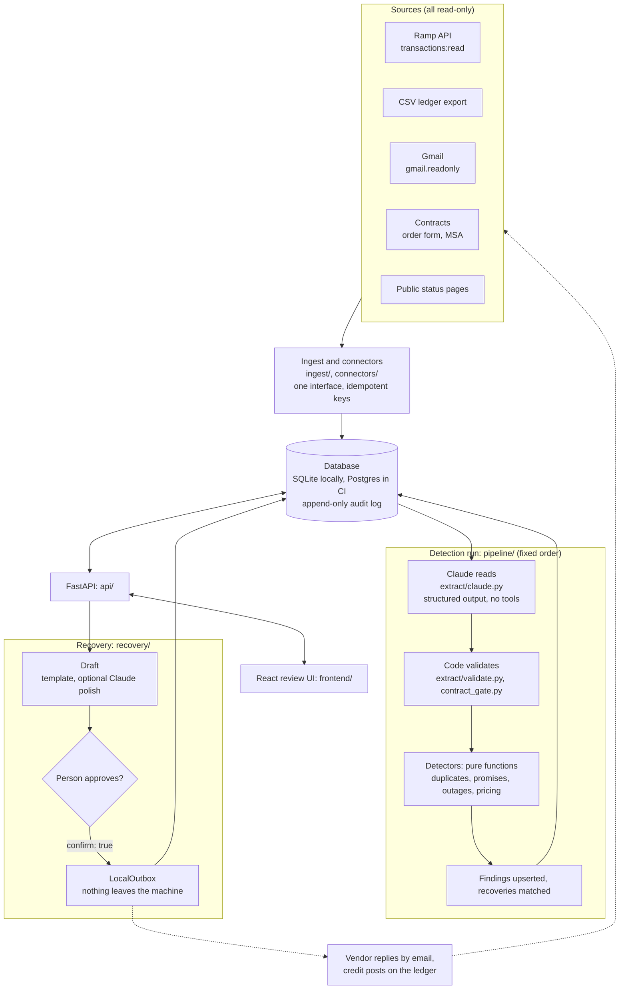
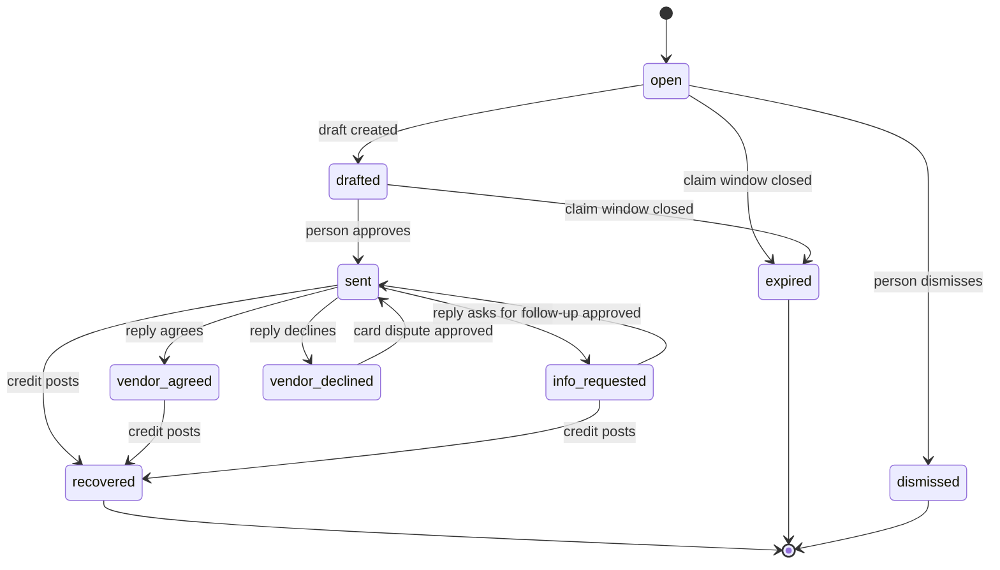

# Architecture

Recoup finds money a company is owed, shows the evidence, and drafts the request to get it back. This page is the three-minute tour: what the pieces are, how one case travels through them, and where the trust boundaries sit. Each decision has a record in [`docs/adr/`](adr/README.md).

Paths are under `backend/src/recoup/` unless shown otherwise.

## The system

Three things are worth noticing:

1. **Every arrow into Recoup is read-only.** Ramp is read with `transactions:read`, Gmail with `gmail.readonly`, status pages are public, and a CSV or contract is an upload.
2. **The model sits in one box and has no exits.** Claude turns text into typed proposals. It has no tools, and nothing it returns is used until code has checked it.
3. **The only way out is through a person.** A message is sent only when the send endpoint gets `{"confirm": true}`, and today "sent" means recorded by `LocalOutbox`. In the demo, a simulated vendor inbox plays the dotted path.

## Layers

| Layer | Package | What it owns | ADR |
|---|---|---|---|
| Domain | `domain/` | Money as integer minor units, transactions, emails, vendors, contracts, promises, the three outcomes, workflow states | [0003](adr/0003-integer-minor-units.md), [0004](adr/0004-discrete-outcomes.md) |
| Ingest | `ingest/` | CSV ledgers (`csv_ledger.py`), Ramp (`ramp.py`), Gmail (`gmail.py`), status pages (`statuspage.py`, `status_feeds.py`), what the company entered in Setup (`company.py`) | [0008](adr/0008-real-data-connectors.md), [0012](adr/0012-company-onboarding.md) |
| Connectors | `connectors/` | The `Connector` protocol (`base.py`), the three shipped connectors (`registry.py`), background sync (`scheduler.py`) | [0009](adr/0009-connector-interface.md) |
| Extraction | `extract/` | Claude calls (`claude.py`, `contract_reader.py`), versioned prompts (`prompts.py`), the keyword baseline (`heuristic.py`), and the gates (`validate.py`, `contract_gate.py`) | [0005](adr/0005-model-reads-code-decides.md), [0007](adr/0007-offline-baseline-and-caching.md), [0011](adr/0011-contract-reader.md) |
| Detectors | `detectors/` | `duplicates.py`, `promises.py`, `outages.py`, `pricing.py`: pure functions from records to finding candidates | [0010](adr/0010-price-overcharges.md) |
| Pipeline | `pipeline/` | The fixed order of one run (`run.py`) and reading the inbox (`inbox.py`) | [0001](adr/0001-workflow-not-agent.md) |
| Recovery | `recovery/` | Case facts, drafting, the outbox, the state machine, matching posted credits (`workflow.py`) | [0006](adr/0006-human-approval-and-ledger-truth.md) |
| Persistence | `db/`, `backend/migrations/` | SQLAlchemy models, sessions, the detection clock, Alembic migrations | [0002](adr/0002-stack.md) |
| API | `api/` | FastAPI routes, schemas, and case timelines built from stored rows | [0002](adr/0002-stack.md) |
| UI | `frontend/` | React review queue, case view, confirm sheet, Setup. Talks only to the API, through `frontend/src/api.ts` | [0002](adr/0002-stack.md), [0012](adr/0012-company-onboarding.md) |
| Demo and data | `demo/`, `synth/`, `data/synthetic/` | The seeded synthetic company with its answer key, and a simulated vendor inbox (only with `RECOUP_DEMO_MODE=true`) | [0007](adr/0007-offline-baseline-and-caching.md) |
| Evals | `backend/evals/` | Scoring detectors and extractors against the answer key; results committed in `evals/results/` | [0007](adr/0007-offline-baseline-and-caching.md) |

`services.py` picks implementations once at startup: Claude when `ANTHROPIC_API_KEY` is set, keyword rules otherwise. Everything downstream depends on the `PromiseExtractor`, `ReplyClassifier`, `Drafter` and `Outbox` protocols, not on which one it got.

## One detection run

`run_pipeline` in `pipeline/run.py` is the whole workflow, and the code fixes its order:

1. **Read the inbox** (`pipeline/inbox.py`). Emails that answer a request we sent, from the address we wrote to, are replies. Every other email goes to the extractor, and each proposal goes through `validate_extraction`. Results are cached per (email, extractor name), and the name includes the model and prompt version.
2. **Detect.** The four detectors run over the ledger, the validated promises, the contracts and the incidents. Each returns `FindingCandidate`s with an outcome, a reason and the evidence.
3. **Upsert.** `upsert_finding` creates or updates a row by a stable key and writes an audit event for every change. Running it again with the same data changes nothing.
4. **Match recoveries.** `match_recoveries` closes a case only when a credit of the right amount from the right vendor has posted since the request went out. Each credit closes at most one case.

A run is started by `recoup run`, by a sync (`POST /api/sync`, `recoup sync`, `recoup watch`), by a ledger import, or by the background scheduler. Only one sync cycle runs at a time.

## One case, end to end

The United Airlines case from the demo:

1. **Ingest.** The ledger holds the original charge. The inbox holds an email from United: "A refund of $612.40 … has been processed."
2. **Read.** The extractor proposes a refund promise with that sentence as its quote and `612.40` as its amount.
3. **Check.** `validate_extraction` confirms the sender's domain is in the vendor directory, the quote appears verbatim in the email, and the amount is a number written in the quote. Only then does it become a `Promise`.
4. **Detect.** `detect_broken_promises` looks for a matching credit on the ledger by the due date. There is none, so it emits a `missing_refund` candidate with outcome `recoverable`.
5. **Show.** `GET /api/findings/{id}` returns the case with its evidence and timeline. The UI shows the quote, the charge, and the search that found no credit.
6. **Draft.** `POST /api/findings/{id}/draft` builds `CaseFacts` from stored rows and drafts the request. The recipient is the vendor's `support_email` from the directory.
7. **Approve.** The person reads it and confirms in the confirm sheet. `POST /api/drafts/{id}/send` requires `{"confirm": true}`, claims the draft so two approvals cannot both send it, hands it to the outbox, and records the approver in the audit log.
8. **Close.** United replies and the reply classifier marks the case `vendor_agreed`. The case becomes `recovered` only when the $612.40 credit appears on the ledger.

## Case lifecycle

A finding has an **outcome** (what it is: `recoverable`, `needs_review`, `not_recoverable`) and a **status** (where recovery stands, `domain/workflow.py`).

A person can dismiss any case that is not already closed; the diagram draws that only from `open`. `recovered` is reached from the ledger alone, never from a vendor's reply.

## Trust boundaries

Recoup holds private financial data, reads untrusted text, and can send mail. Each of those is constrained in code, not in a prompt.

| Boundary | Rule | Enforced in |
|---|---|---|
| Model output | A proposal becomes a promise only with a directory sender, a verbatim quote, and an amount written in that quote. A cancellation date counts only if the email states it. | `extract/validate.py` |
| Contracts | Each clause must appear verbatim in the document, each number must be written in it, and the vendor must be in the directory. Nothing is saved until a person confirms. | `extract/contract_gate.py`, `api/routes/discovery.py` |
| Prompt injection | Email and documents are fenced as data, the output schema has no actions, and no model call has tools. An injected email can at most add a case for a person to review. `tests/test_injection.py` swaps in a fully hijacked extractor and asserts nothing harmful happens. | `extract/prompts.py`, `extract/claude.py` |
| Inbound mail | The Gmail query asks only for mail from directory domains. A message is kept only if Gmail's own topmost `Authentication-Results` header shows DMARC or DKIM passing for the sender's domain. Attachments are never read. | `ingest/gmail.py` |
| Replies | A reply moves a case only if it comes from the address we wrote to; `In-Reply-To` alone is forgeable. | `pipeline/inbox.py` |
| Recipients | Addresses come from the vendor directory a person entered, or the configured card-dispute address. Never from email content or model output. | `recovery/workflow.py` |
| Sending | `{"confirm": true}` is required, the approver is audited, and the draft is claimed before it is sent. The only outbox is `LocalOutbox`. | `api/routes/drafts.py`, `recovery/outbox.py` |
| Money posted | Read from the ledger alone. | `recovery/workflow.py` |
| Secrets | API keys and OAuth tokens are read server-side; the browser only ever calls `/api`. CI runs gitleaks. | `config.py`, `.github/workflows/ci.yml` |

Known limit: the API has no login. It is built to run on one person's machine, and the approver name is self-reported.

## What keeps it honest

- **Tests.** `backend/tests/` covers units, the API, the CLI, the connectors against documented response shapes, and the injection red-team. `frontend/e2e/recoup.spec.ts` drives the UI through review, send, advance and dismiss.
- **Evals.** `make eval` scores the detectors over five seeded worlds and the extractors over the labelled emails, and writes `backend/evals/results/`.
- **CI** (`.github/workflows/ci.yml`). Lint, strict mypy and the tests run against SQLite and Postgres 16. CI also fails if the migrations do not match the models, if `data/synthetic/` differs from what the generator writes, or if the committed eval tables differ from what the code produces.

What has not been run: the Ramp connector against a real sandbox, the Gmail connector against a real mailbox, and the Claude row of the extraction eval. The [README](../README.md) says so in each place.
